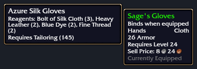
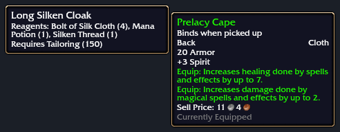

# TrainerCompare

At a profession trainer in **WoW Forever**, recipes that make gear show what you're wearing
in that slot beside the tooltip, the way any other item does.

| Azure Silk Gloves | Long Silken Cloak |
|---|---|
|  |  |

## What it does

A trainer's recipe tooltip isn't an item tooltip, so the game never puts the "Currently
Equipped" comparison next to it. TrainerCompare finds the item the recipe makes and, when it's
something you can wear, shows your equipped item in the usual comparison tooltips:

- Both rings, both trinkets, or both hands for a one-handed weapon, when you have two on.
- Beside the recipe tooltip on the right, or on the left when there's no room.
- It stays up when the game redraws the tooltip (pressing Shift, item data arriving).

Works for every profession that makes gear: Tailoring, Leatherworking, Blacksmithing,
Engineering. Recipes that make something you can't wear are left alone.

There are no settings or commands: install it and hover a recipe at a trainer.

## Install

Download this repository (green **Code** button, **Download ZIP**), and copy the
`addons\TrainerCompare` folder into `World of Warcraft\_forever_\Interface\AddOns`, so that you
end up with `AddOns\TrainerCompare\TrainerCompare.toc`. Restart WoW fully (a `/reload` doesn't
find new addons).

No other addons needed. Item comparison addons such as
[Pawn](https://www.curseforge.com/wow/addons/pawn) add their lines to the comparison tooltips
as usual.

## Limits

- It shows your equipped item next to the recipe; it doesn't compute stat differences.
- It needs the game to know the recipe's item. For the odd recipe it doesn't, there's no
  comparison.

## Licence

[MIT](LICENSE)
